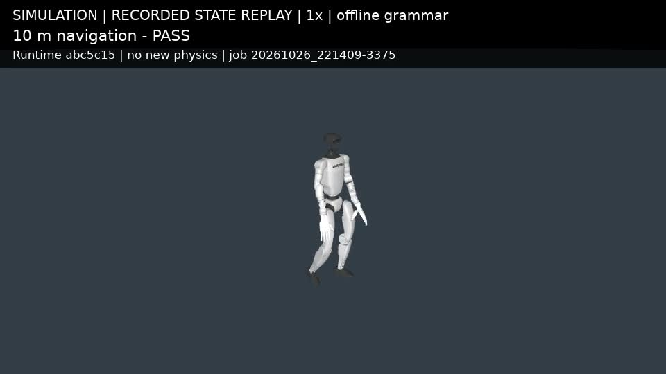
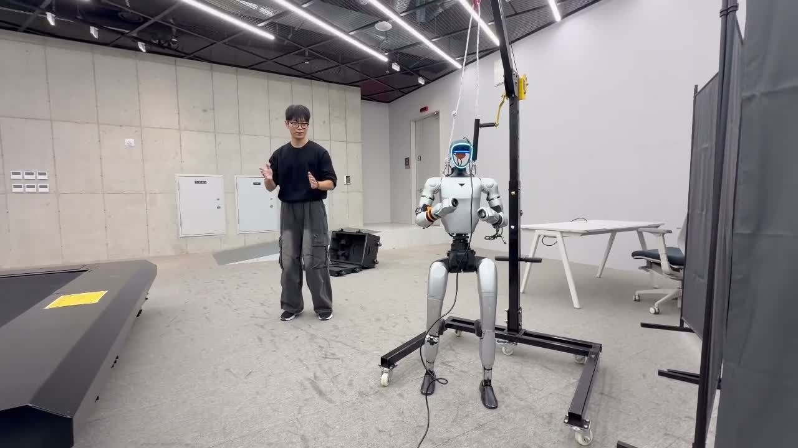
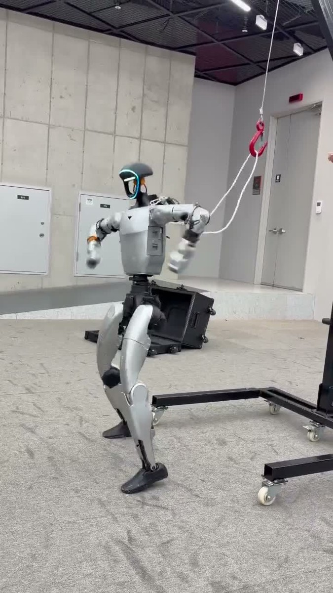
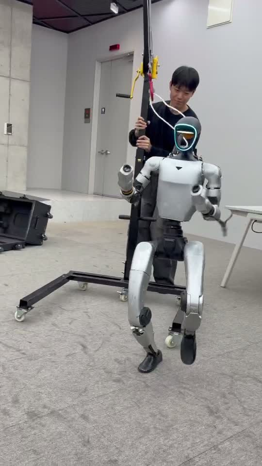
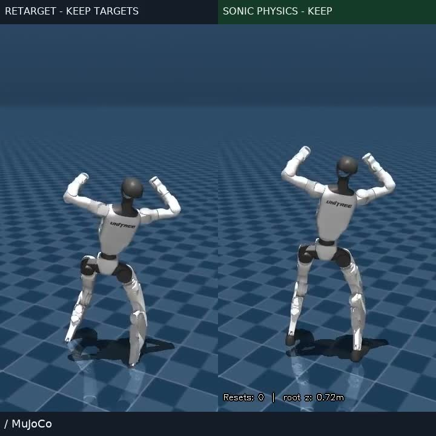

# SHAPE-UP G1

Unitree G1과 NVIDIA SONIC을 바탕으로 휴머노이드 원격조작과 미션 실행을 실험하는 SHAPE 팀 프로젝트.
시뮬레이션 환경부터 조작 콘솔, ROS 2 연동과 실물 원격조작까지 박세환이 직접 구현했다.
이 저장소에 개발 과정과 시연을 정리했다.

- **성격:** 팀 로봇 프로젝트 · 2026년 가을
- **주요 작업:** G1 시뮬레이션 · 조작 콘솔 · ROS 2 연동 · 미션 실행·검증
- **기술:** Python · ROS 2 · MuJoCo · NVIDIA SONIC

2026-10-26 시뮬레이션 기록 재생. 이미지를 누르면 영문 설명 영상을 볼 수 있다. 실제 로봇 동작 영상이 아니며, 오프라인 명령으로 수행한 실행 기록이다.

## 실물과 동작 시연

실물 G1 원격조작 시연. 11월 2일 Slack에 공유된 IMG_4997 영상의 장면.

지지 장치에 연결한 실물 G1 시연. 같은 날 공유된 IMG_4996 영상의 장면.

실물 G1의 장비 준비·조작 환경. 발표자료에 수록된 현장 사진.

목표 자세와 MuJoCo 물리 상태를 나란히 비교한 시뮬레이션 장면. 실물 사진과 구분한 기록이다.

## 프로젝트 개요

사람의 입력을 휴머노이드 동작으로 연결하고, 같은 조건에서 동작과 실패를 확인할 수 있는 실험 환경을 만드는 작업이다.
SONIC의 전신 제어를 기반으로 조작 입력, 미션 상태, 로봇 관측과 시뮬레이션을 연결했다.

| 구분 | 역할 |
| --- | --- |
| 기반 기술 | NVIDIA SONIC의 전신 제어와 Unitree G1 모델 |
| 본인 구현 | 시뮬레이션 환경, 조작 콘솔·ROS 2 연결, 사람 동작 추적과 실물 원격조작, 미션 실행·검증 |

## 구현 내용

- **시뮬레이션 환경:** SONIC과 MuJoCo를 연결하고 실행·렌더링 기록을 남겼다.
- **조작 콘솔:** 입력과 로봇 상태를 한 화면에서 확인하고, 정지·재개와 조작 권한을 다루는 흐름을 구성했다.
- **미션 실행:** 지령을 이동·정지 등 실행 단계로 연결하고, 상태와 관측을 ROS 2 인터페이스로 주고받도록 구성했다.
- **실물 원격조작:** 사람 동작 입력과 G1을 연결해 실물 장비에서 원격조작을 시연했다.
- **검증 자료:** 자동 입력 실험과 실제 사람의 조작, 시뮬레이션과 실물을 구분해 시연 영상과 인수인계 자료를 정리했다.

## 검증 현황

아래는 **2026-10-26~27에 남긴 본인 작업 기록**의 범위다. 이후 실물 시연은 아래 사진에 별도로 표시했다.

| 항목 | 확인한 범위 |
| --- | --- |
| 장애물 없는 10m 이동 | 10월 26일 시뮬레이션에서 통과 |
| 낮은 장애물·컵 조작 | 당시 최종 실행에서 실패. 컵 미션 10회 중 완료 0회이며, 초기 장면 충돌도 포함되어 일반 성공률로 해석할 수 없음 |
| 키보드 조작 경로 | 10월 27일 자동 입력 기록. 동작·접촉 기준 실패가 남아 있으며 사람의 직접 조작 수락 검증은 미완료 |
| 실물 원격조작 | 11월 2일 Slack에 공유된 실물 시연 영상 확인. 실물에서 전체 미션을 수행한 검증과는 구분 |

## 사용 범위와 한계

프로젝트 소개와 선별한 시연 자료만 공개한다. 실행 코드, 모델 가중치, 내부 설정, 팀 회의 기록은 포함하지 않는다.
영상은 저장된 물리 상태를 재생한 자료이며 새 물리 시뮬레이션이나 온라인 언어 모델 호출을 보여주지 않는다.
로봇과 전신 제어 기반은 원본 프로젝트의 기여이며, 이 문서는 별도의 제어 모델을 개발했다는 의미가 아니다.

사진과 영상의 출처는 [시연 자료 기록](docs/media-sources.md)에 정리했다.

## 관련 프로젝트

- [NVIDIA GR00T Whole-Body Control / SONIC](https://github.com/NVlabs/GR00T-WholeBodyControl) — 전신 제어 기반
- [SHAPE](https://github.com/snu-shape) — 소속 로봇 팀
- [AI Worker 휴머노이드 챌린지](https://github.com/sesepark/ai-worker-humanoid-challenge) — 앞서 원격 조작 화면·카메라·리더암을 담당한 팀 프로젝트
- [xArm7 Teleop](https://github.com/sesepark/xarm7-pi0-teleop) — 로봇팔 원격조작·시연 데이터 수집 실험
